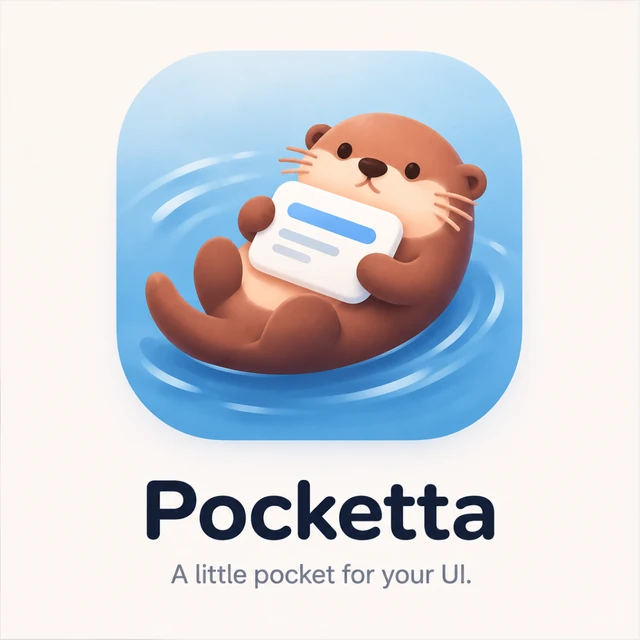
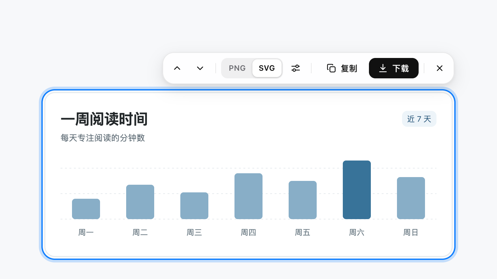

  

# Pocketta

从 ChatGPT 回复里取出一张卡片、一幅图或一份表格。Pocketta 在浏览器中完成导出：用 PNG 将组件贴进笔记，用原生 SVG 在设计工具里继续改文字和颜色。

上图使用示例数据和真实工具条。查看同一卡片的导出结果：[PNG 图片](docs/media/reading-week.png) · [可编辑 SVG](docs/media/reading-week.svg)。

## 安装

1. 下载并解压仓库 ZIP，或将仓库克隆到本地。把文件夹放在可以长期保留的位置。
2. 在 Chrome 或 ego-lite 中打开 `chrome://extensions`，开启「开发者模式」。
3. 点击「加载已解压的扩展程序」，选择仓库中的 [extension](extension/) 文件夹。这一层直接包含 `manifest.json`，无需编译或安装 npm 依赖。
4. 打开一条含有 Intelligent UI 的 ChatGPT 对话。将鼠标移到组件上，点击右上角出现的导出按钮。已打开的对话若未出现入口，刷新页面即可。

## 导出第一张卡片

蓝色边框标出将被导出的范围。想取整张卡片，选择格式后点击「下载」。想单独取出其中的图表，可以点击卡片内部，或按 **→** 进入子组件，按 **←** 回到外层。点击设置按钮可调整背景、清晰度或文字，并查看导出尺寸。

| 操作 | PNG | SVG |
| --- | --- | --- |
| 复制 | 将图片写入剪贴板，适合粘贴到笔记或聊天里 | 将 SVG 源码写入剪贴板 |
| 下载 | 保存 `.png`，可选 1×、2×、3× | 保存独立的 `.svg`，可导入 Figma 等设计工具 |
| 背景 | 页面底色或透明 | 整卡可选底色或透明，单独提取源矢量图时保留原图透明区域 |

透明背景保留组件自身的色块和边框。下载文件名取自组件的第一行文字。

### SVG 能保留什么

对于页面已有的 SVG，Pocketta 直接提取支持的图形、渐变和裁剪。导出整张卡片时，外围背景、边框和文字按当前布局组合，常见图表里的单行 HTML 标签也可转成 SVG 文字。

- **可编辑文字**适合继续改文案。接收设备缺少字体时，字形可能发生变化。
- **转为轮廓**会把卡片、源图和图表标签的字形描摹为路径，适合跨设备保留外观。文件通常更大，文字也无法再搜索或编辑。
- 选区包含照片、复杂滤镜或无法独立保存的资源时，工具条会说明原因。可缩小选区，或点「改用 PNG」重试刚才的操作。

### 键盘操作

| 按键 | 操作 |
| --- | --- |
| Alt+Shift+E（macOS 为 ⌥⇧E） | 打开或关闭工具条 |
| ↑ / ↓ 或 K / J | 选择上一个或下一个组件 |
| → / ← | 进入子组件或返回外层 |
| P / S | 切换 PNG 或 SVG |
| C、⌘C 或 Ctrl+C | 复制 |
| Enter | 下载，或执行当前聚焦按钮的操作 |
| ? / Esc | 查看快捷键 / 退出 |

长对话中，选区滚出屏幕后可点「返回组件」。上下切换会寻找尚未挂载的组件，滚轮或触摸滚动可中止查找。启动快捷键可在 `chrome://extensions/shortcuts` 调整。

## 权限与隐私

Pocketta 只在 `https://chatgpt.com/*` 上识别组件。`scripting` 用于按需加载导出工具，`storage` 用于在本机记住导出设置与快捷键提示状态。图片和 SVG 图集按需从页面原有地址读取，跨域读取失败会提示错误。组件内容在本地渲染，无需连接导出服务。完整声明见 [manifest.json](extension/manifest.json)。

## 适用范围

选取入口适用于 ChatGPT 回复中的结构化 UI。独立的普通 Markdown 段落、代码块和列表不提供入口。导出记录当前显示状态，折叠内容与内部滚动区不会自动展开。

Canvas、视频、iframe 和开放的 Shadow DOM 目前不支持导出。PNG 上限为 3200 万像素、单边 16384 像素。ChatGPT 调整页面标记后，组件识别可能需要随之更新。

## 开发与反馈

在仓库根目录运行 `npm run check` 可检查脚本语法、扩展清单和打包文件。浏览器回归覆盖 PNG / SVG 渲染、选择与复制、280px 窄屏和视觉保真度。环境准备、测试命令和问题报告建议见[贡献指南](CONTRIBUTING.md)。

## 许可证

项目代码和文档采用 [MIT 许可证](LICENSE)。[水獭插图](docs/media/pocketta-otter.webp)经授权随本仓库分发，单独使用该图需另行取得授权。
