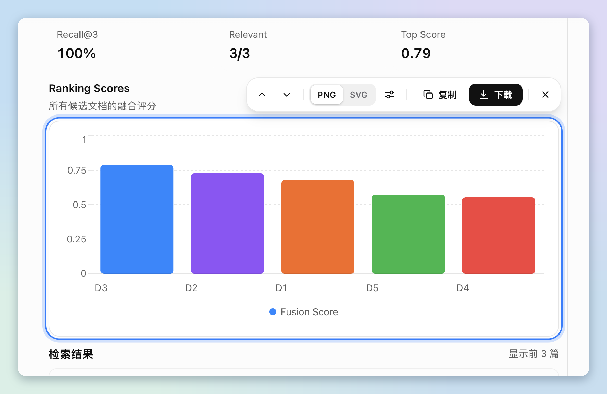
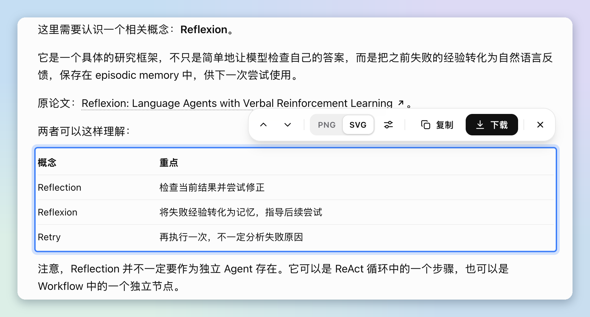
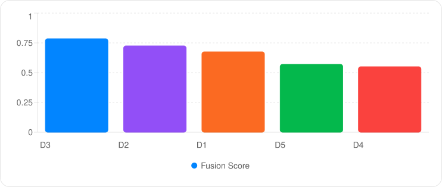

<p align="center">
  
</p>

<p align="center">
  把 ChatGPT 的卡片、图表和表格装进口袋：<br>
  导出为 PNG 图片，或文字可编辑的 SVG。
</p>

<p align="center">
  <a href="https://github.com/novye7/pocketta/actions/workflows/check.yml"></a>
  <a href="LICENSE"></a>
</p>

<p align="center">
  <a href="#安装">安装</a> ·
  <a href="#使用">使用</a> ·
  <a href="#png-还是-svg">PNG 还是 SVG</a> ·
  <a href="#隐私与权限">隐私</a> ·
  <a href="#常见问题">常见问题</a> ·
  <a href="#贡献">贡献</a>
</p>



在这段[公开对话](https://chatgpt.com/share/6b056cc6-98c4-83e9-b234-f9a93ccbb3cf)里，ChatGPT 展示了五篇候选文档的检索评分。蓝框标出要导出的图表，上方的指标和下方的检索结果都在选区之外。

Pocketta 是一个 Chrome 扩展。ChatGPT 的回复里除了文字，还会出现卡片、图表、表格这样的界面组件（Intelligent UI）。想把其中一块单独留下来，靠截图就得自己对齐裁边，清晰度受屏幕限制，里面的文字和颜色也没法再改。

Pocketta 让你直接选中一个组件，按它本身的边界导出：PNG 适合贴进笔记和聊天，SVG 适合放大展示，或者放进设计工具接着改。整个过程都在你的浏览器里完成。

## 功能

- **悬停即选。** 鼠标移到组件上，右上角会浮出导出按钮，点一下就选中它。
- **范围可大可小。** 可以导出整张卡片，也可以只取里面的一幅图表或某一个区块。
- **PNG 图片。** 1×、2×、3× 三档清晰度，背景可以用页面底色，也可以透明。
- **原生 SVG。** 文字、色块、边框、圆角和渐变都是真正的矢量元素，不是把位图包一层 SVG。文字可以保持可编辑，也可以转成轮廓。
- **复制或下载。** PNG 复制后能直接粘贴到笔记和聊天里，SVG 复制的是源码。下载的文件以组件的第一行文字命名。
- **不离开键盘。** 换组件、调范围、切格式、复制和下载都有快捷键。
- **只在本地运行。** 不上传内容，没有遥测，也没有第三方依赖。

## 安装

Pocketta 目前通过「加载已解压的扩展程序」安装，适用于 Chrome 和其他 Chromium 内核的浏览器。

1. **下载代码。** 克隆仓库，或者在 GitHub 页面点 **Code → Download ZIP** 后解压。文件夹要放在一个不会被清理掉的位置，浏览器之后会一直从这里读取扩展。

   ```sh
   git clone https://github.com/novye7/pocketta.git
   ```

2. **打开扩展管理页。** 在地址栏输入 `chrome://extensions`，打开右上角的「开发者模式」。
3. **加载扩展。** 点击「加载已解压的扩展程序」，选择仓库里的 [`extension`](extension/) 文件夹。注意是里面这一层，不是仓库根目录。

不需要 `npm install`，也没有构建步骤。以后更新时，换上最新的代码，再到扩展管理页点一下 Pocketta 卡片上的刷新按钮。

## 使用

1. **选中一个组件。** 打开一条含有卡片、图表或表格的 ChatGPT 对话，把鼠标移到组件上，点击右上角浮出的导出按钮。也可以点浏览器工具栏上的 Pocketta 图标，或者按 `Alt+Shift+E`（macOS 上是 `⌥⇧E`），这时会选中离窗口中央最近的组件。
2. **调整范围。** 蓝色边框圈住的就是会被导出的内容。只想要其中一部分，就在那个部分上点一下，每点一次往里收一层，收到最里面再点一下就回到整个组件。也可以按 `→` 往里收，按 `←` 往外放。按 `↑` `↓` 可以换到上一个、下一个组件。
3. **导出。** 在工具条上选 PNG 或 SVG，然后点「复制」或「下载」。点开选项按钮可以调整背景、清晰度和文字的处理方式，还能看到导出尺寸。

按 `Esc`，或者点一下组件以外的地方，就会退出。格式和选项会被记住，下次打开时沿用。



### 快捷键

| 按键 | 作用 |
| --- | --- |
| `Alt+Shift+E`（macOS：`⌥⇧E`） | 打开或关闭工具条 |
| `↑` `↓`，或 `K` `J` | 上一个、下一个组件 |
| `←` `→` | 扩大到外层、缩小到内层 |
| `P` `S` | 切换到 PNG、SVG |
| `C`，或 `⌘C` / `Ctrl+C` | 复制 |
| `Enter` | 下载 |
| `?` | 显示或收起快捷键提示 |
| `Esc` | 退出 |

打开工具条的快捷键可以在 `chrome://extensions/shortcuts` 里修改。

对话很长时，ChatGPT 只在页面里保留窗口附近的几轮内容。用 `↑` `↓` 走到已加载内容的尽头后，Pocketta 会自动滚动页面继续找，滚一下鼠标滚轮就能中止。选中的组件滚出屏幕后，工具条上会出现「返回组件」。

## PNG 还是 SVG

| | PNG | SVG |
| --- | --- | --- |
| 适合 | 贴进笔记、聊天和幻灯片 | 放大展示，或放进设计工具接着改 |
| 复制到剪贴板的是 | 图片 | SVG 源码 |
| 可调的选项 | 清晰度（1×、2×、3×）、背景 | 文字（可编辑、转为轮廓）、背景 |
| 遇到照片、滤镜这类内容 | 照常导出 | 提示改用 PNG |

背景选「透明」时，只是不再铺页面的底色，组件自己的色块和边框都会保留。

下面是开头那张评分图导出的 SVG。放大后，柱形和刻度依然清晰，文档编号和图例文字可以继续编辑。也可以打开[同一选区的 2× PNG](docs/media/ranking-scores.png) 对照。

<p align="center">
  
</p>

SVG 里的文字有两种处理方式：

- **可编辑**（默认）。文件小，文字可以搜索，也可以继续改。打开文件的设备上如果没有对应的字体，会换用别的字体，字形可能略有出入。
- **转为轮廓。** 把每个字都描成路径，在哪里打开外观都一样。代价是文件更大，文字不能再搜索和编辑。Emoji 这类彩色字形无法转成轮廓。

SVG 导出只接受能画成矢量的内容。选区里有照片，或者用到了滤镜、变换这类暂不支持的效果时，工具条会说明原因，并给出「改用 PNG」按钮，点一下就用 PNG 重做刚才的复制或下载。也可以把范围缩小到不含这些内容的那一部分。

## 已知限制

- 只识别 ChatGPT 回复里的组件。普通的段落、列表和代码块不在范围内。
- 导出的是组件当前显示的样子，折叠起来的内容和内部滚动区里没露出来的部分不会自动展开。
- 不支持含有 Canvas、视频、音频、iframe 或 Shadow DOM 的组件。
- PNG 最大 3200 万像素，单边最长 16384 像素。超出时可以降低清晰度，或者缩小选取范围。
- 组件里的图片需要能被页面重新读取，受跨域限制的图片会导致导出失败。
- 界面目前只有中文。
- 组件的识别依赖 ChatGPT 当前的页面结构。ChatGPT 改版后，扩展可能需要跟着更新。

## 隐私与权限

- 扩展只在 `https://chatgpt.com/*` 上运行，读取页面结构是为了找出可以选取的组件。
- 它申请两项权限：`scripting` 用来在你点下导出按钮时把导出工具加载进页面，`storage` 用来在本机记住格式、清晰度这些设置。
- 导出在浏览器里完成。组件引用的图片和图标需要重新读取时，浏览器会向它们原本的地址发出请求。除此之外，扩展不发起任何网络请求，没有遥测，也不会把页面内容或导出结果发给开发者或任何服务器。
- 生成的文件只会进入你的剪贴板，或者由浏览器保存到下载目录。

权限的完整声明见 [manifest.json](extension/manifest.json)。

## 常见问题

**鼠标移到组件上，没有出现导出按钮？**

先刷新一下对话页面，再到 `chrome://extensions` 确认 Pocketta 处于启用状态。按钮只出现在卡片、图表、表格这类组件上，普通的段落和代码块上没有。

**点了工具栏图标，图标上出现红色的「!」？**

多半是当前标签页不在 `chatgpt.com`。把鼠标停在图标上，可以看到具体的原因。

**提示「无法写入剪贴板」？**

浏览器只允许处于焦点状态的页面写剪贴板。点一下页面再复制，或者改用下载。

**SVG 在别的软件里打开，字体变了？**

那个软件或那台设备上找不到原来的字体。导出时把文字选项改成「转为轮廓」，外观就固定下来了。

**导出的结果和页面上看到的不一样？**

欢迎[提一个 issue](https://github.com/novye7/pocketta/issues)，写明组件类型、导出格式和所选的选项。示例请用可以公开的内容，不要贴私人对话。

## 实现思路

- **识别组件。** ChatGPT 把一条回复渲染成一棵带类型标记的节点树。Pocketta 把其中的正文、行内元素和表格内部的行列排除掉，剩下的就是可以选取的组件。
- **导出 PNG。** 交给浏览器自己的排版引擎：克隆组件，固化计算后的样式，把图片内嵌进去，再经由 SVG 的 `foreignObject` 画到 Canvas 上。
- **导出 SVG。** 不借助 `foreignObject`，而是测量页面上每个盒子和每个字符的位置，用路径、渐变、裁剪和 `<text>` 重新画一遍。页面里原有的 SVG 图标和图表，筛出静态图元后直接搬进来。
- **文字转轮廓。** 不需要字体文件：每个字形先用页面的字体画到 Canvas 上，再沿着边缘描成路径。

## 开发

扩展是不带依赖的原生 JavaScript。改完代码，到扩展管理页重新加载，再刷新对话页面，就能看到效果。

| 命令 | 作用 |
| --- | --- |
| `npm run check` | 检查脚本语法、manifest 和打包文件 |
| `npm run test:browser` | 浏览器回归：渲染、选取交互、窄屏布局和 SVG 视觉保真度 |

`npm run check` 只需要 Node.js。浏览器回归还要装 agent-browser，跑的是本地夹具，不需要登录 ChatGPT。

## 贡献

感谢 Codex 和 Claude 在 Pocketta 开发过程中提供协助。

欢迎提交 issue 或 pull request。环境准备、代码结构和报告导出问题时需要的信息，见[贡献指南](CONTRIBUTING.md)。

## 许可证

代码和文档采用 [MIT 许可证](LICENSE)。[水獭插图](docs/media/pocketta-otter.webp)不在 MIT 许可的范围内：它可以随本仓库一起分发，单独使用需要另行取得授权。
